  

  Most AI tools ask you to upload your life first. I like building the other kind: 
  a model that runs on your own machine, an agent that writes down every decision it makes, 
  and an app that tells you what went wrong in a sentence instead of a chart.

  <a href="https://nandini-patil-portfolio.onrender.com/"><b>Portfolio ↗</b></a>
  &nbsp;&nbsp;&nbsp;&nbsp;
  <a href="https://github.com/Nandinipatil1410?tab=repositories"><b>All repositories ↗</b></a>

 

  

 

  

  
  
  
  

  

 

  

  
    Try them live:
    <a href="https://retainx-f90n.onrender.com/">RetainX</a>,
    <a href="https://brainboardnotes.onrender.com/">brainBoard</a>,
    <a href="https://agriseva.vercel.app">AgriSeva</a>
  

 

  

 

  

  

